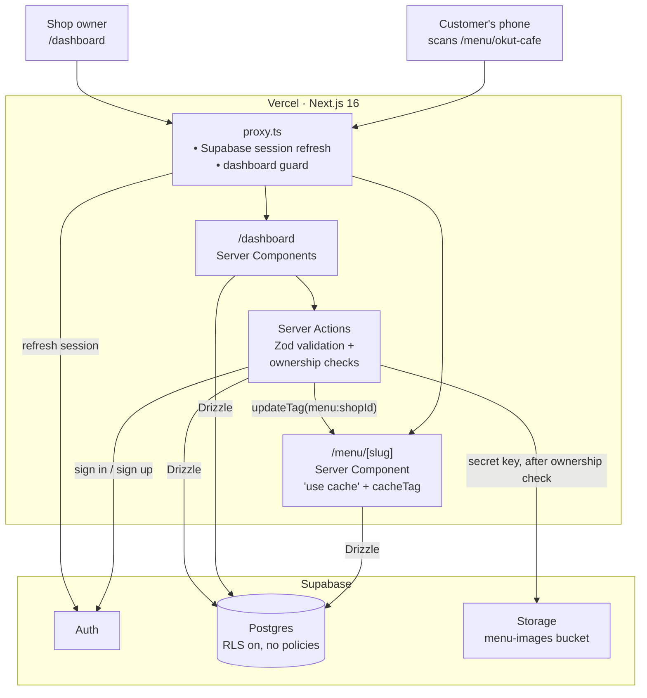
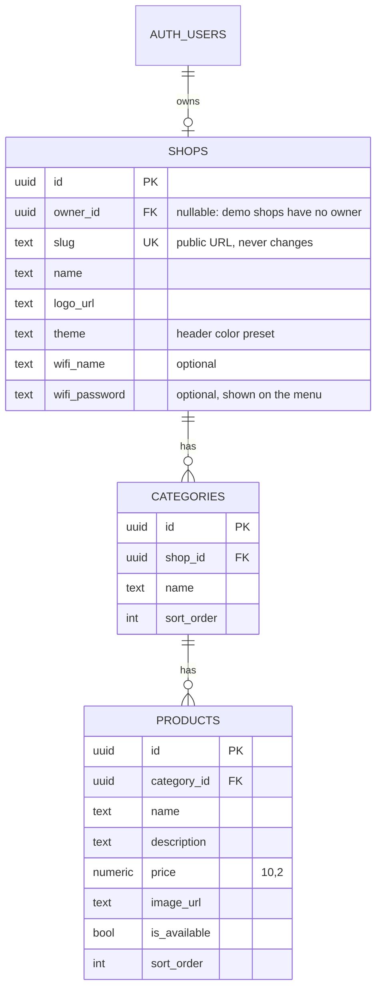

# Okut

**QR-code digital menus for cafés and restaurants.** Owners build their menu in a dashboard and print a QR table card; customers scan it and the menu opens in their phone's browser. No app, no sign-up.

**Live:** [okut.vercel.app](https://okut.vercel.app) · Demo menu: [Okut Cafe](https://okut.vercel.app/menu/okut-cafe)

*Okut* is Turkish for "scan it". The product targets cafés in Turkey, so the interface is in **Turkish**; this README is in English for reviewers. It briefly shipped in English and Spanish too; I narrowed the scope to one market and removed the multi-language layer rather than keep machinery no page used (see [Single language](#single-language)). The logo's "o" is a QR code's finder pattern, and the brand colour is *tavşan kanı*, the deep red of well-brewed Turkish tea. Light and dark themes follow the device setting, or a light/dark/system switch in the header (remembered per device, applied before first paint so there's no flash). QR codes and the printable table card always stay light so cameras and printers read them.

| | |
|---|---|
| **Stack** | Next.js 16 (App Router, Server Actions, Cache Components) · React 19 · TypeScript · Supabase (Auth, Postgres, Storage) · Drizzle ORM · Zod · Tailwind CSS 4 · shadcn/ui |
| **Hosting** | Vercel (app) · Supabase (database, auth, file storage) |
| **Highlights** | Multi-tenant authorization in code with RLS as a backstop · static prerendering · tag-based cache invalidation · client-side image compression · Turkish-format price input and display |

---

## Try it

1. Open [okut.vercel.app](https://okut.vercel.app). The interface is in Turkish; your browser's translate feature works well on it.
2. Scan the QR code in the "Canlı demo" (live demo) section with your phone, or click "Menüyü bu cihazda aç" (open the menu on this device), to see Okut Cafe's menu as a customer would.
3. Tap a menu item to open its detail sheet.
4. Click **Create your shop** to try the dashboard: add categories, products and photos, mark items sold out, download your QR code or print a table card.

## Features

**For shop owners**
- **Menu editor:** categories and products with prices, descriptions and photos, edited inline.
- **Sold-out toggle** with optimistic UI: the item stays on the menu, greyed out with a "Sold out" badge.
- **Photo uploads:** resized to at most 1200 px and re-encoded to WebP in the browser before upload, so phone photos typically shrink to a few hundred KB.
- **QR codes:** download as PNG or SVG, or print a ready-made table card.
- **Overview:** menu stats, recently edited items and a "menu health" check for missing photos or descriptions.
- **Settings:** rename the shop (the menu URL never changes, so printed QR codes keep working), upload a logo (shown on the menu, the sidebar and the table card), pick one of six header colors with a live preview, and optionally share the guest Wi-Fi.

**For customers**
- Mobile-first menu with sticky category navigation and a bottom-sheet detail view for each item.
- Guest Wi-Fi behind a header icon: a bottom sheet on phones (a dialog on larger screens) with a one-tap copy for the password.
- Served from cache, refreshed the moment the owner saves a change.

## Architecture



### Data model



Deleting a user cascades to their shop, categories and products.

## Engineering decisions

### Security and multi-tenancy
- **All data access is server-side.** Pages and Server Actions query Postgres through Drizzle. Row Level Security is enabled on every table with **no policies**, so even with the publishable key from the browser, the Supabase Data API can't read or write a single row. RLS is the backstop; authorization lives in code.
- **Every write is scoped to the caller's shop.** Each Server Action resolves the signed-in user's shop (`requireUserId` → `getOwnedShop`) and filters every query by it. Passing another shop's category or product ID simply matches nothing.
- **Uploads go through the server.** Photos are validated (type and size, also enforced by the bucket), uploaded with the secret key only after the ownership check, and old files are deleted when replaced.
- **CSRF protection.** Mutations are Server Actions, which Next.js only accepts from the app's own origin.
- **Safe post-login redirects.** The `next` parameter is resolved as a URL and rejected unless it stays on the site, which blocks tricks like `/\evil.com`.
- **Read-only demo without special cases.** The demo shop has `owner_id = NULL`. Since every dashboard query looks up "the shop owned by this user", no account can ever reach it; no `isDemo` flag needed.

### Single language
Okut first ran in Turkish, English and Spanish, with every page under `app/[lang]`, a proxy that picked the visitor's language, per-row `translations` columns and a currency per shop. Once the product focused on Turkey, I removed all of it instead of keeping one-entry lists around.

- **One strings module.** Every UI string lives in `src/lib/dictionary.ts`, imported directly by Server and Client Components, with `fill()` for placeholders. No provider, no per-request lookup, and nothing stops pages from being prerendered.
- **Old links keep working.** `/tr/...`, `/en/...` and `/es/...` URLs redirect permanently to the same page without the prefix (`next.config.ts`), so shared links and printed QR codes from before still open.
- **Money in lira.** Prices are stored as `numeric(10,2)` and shown with `Intl.NumberFormat("tr-TR")` ("₺1.250,50"). Owners type prices the way they write them (`1.250,50`); the parser also accepts `1250.50`.

### Performance
- **Cached menus with precise invalidation.** `getPublicMenu` uses `"use cache"` and tags each entry with `menu:<shopId>`. Owner edits call `updateTag()`, so only that shop's menu is regenerated. Unknown slugs are cached for minutes instead of forever, so a newly created shop never gets stuck on a cached 404.
- **Static where possible.** The landing page, including its QR code, is prerendered; the public menu uses Partial Prerendering.
- **Small images.** Photos are compressed in the browser before upload and served through `next/image`.

## Project structure

```
src/
├── app/
│   ├── page.tsx                # Landing page
│   ├── dashboard/              # Owner dashboard: overview, menu editor, QR codes, settings
│   ├── menu/[slug]/            # Public, cached customer menu
│   └── auth/                   # Sign-in / sign-up Server Actions, email confirmation
├── components/                 # Auth dialog, theme menu, landing sections, shadcn/ui
├── db/schema.ts                # Drizzle schema (single source of truth for migrations)
├── lib/                        # UI strings, auth, storage, menu caching, QR, formatting
└── proxy.ts                    # Session refresh, dashboard guard
drizzle/                        # Generated SQL migrations
scripts/
├── seed-demo-menu.mts          # Creates the read-only demo café
├── demo-menu.mts               # Demo menu data
└── demo-images/                # Demo photos (see CREDITS.md)
```

## Running locally

**Requirements:** Node.js 20+, pnpm and a free [Supabase](https://supabase.com) project.

```bash
pnpm install
cp .env.example .env.local   # fill in from Supabase: Connect, Project Settings → API Keys
pnpm db:migrate              # tables and the menu-images storage bucket
pnpm db:seed                 # optional: the demo café
pnpm dev                     # http://localhost:3000
```

`SUPABASE_SECRET_KEY` is used on the server only and must never be exposed to the browser.

| Command | Description |
|---|---|
| `pnpm dev` | Development server |
| `pnpm build` / `pnpm start` | Production build and server |
| `pnpm lint` / `pnpm typecheck` | ESLint / route types + TypeScript |
| `pnpm db:generate` | Generate a migration from schema changes |
| `pnpm db:migrate` | Apply migrations |
| `pnpm db:studio` | Drizzle Studio |
| `pnpm db:seed` | Create or refresh the demo café |

## Deploying

The live app runs on Vercel. Set `NEXT_PUBLIC_SUPABASE_URL`, `NEXT_PUBLIC_SUPABASE_PUBLISHABLE_KEY`, `SUPABASE_SECRET_KEY` and `DATABASE_URL` (the transaction pooler, port 6543) for every environment; `DIRECT_URL` is only needed for migrations and seeding. In Supabase, set **Authentication → URL Configuration** so the Site URL is the deployed domain and `/auth/confirm` is an allowed redirect. Vercel's `VERCEL_PROJECT_PRODUCTION_URL` is used to prerender the landing page QR code with the right domain.

## Known limitations and next steps

- **Automated tests.** There are none yet; end-to-end tests (Playwright) for sign-up, menu editing and the public menu are the first thing I'd add, followed by CI on pull requests.
- **Abuse limits.** Sign-up is open and there are no per-shop limits on categories, products or uploads yet. Uploads are checked by declared MIME type; verifying file signatures is planned.
- **Free-tier pausing.** Supabase pauses free projects after a week without database activity; a daily keep-alive cron is planned.
- **Email confirmation** is currently off; turning it on needs a custom SMTP provider.
- **Not in the dashboard yet:** reordering categories and products, and deleting a shop or account.

## Credits

The wordmark and link previews use [Bricolage Grotesque](https://fonts.google.com/specimen/Bricolage+Grotesque) (SIL Open Font License, see [`assets/fonts/OFL.txt`](assets/fonts/OFL.txt)). Demo photos are from [Unsplash](https://unsplash.com), used under the [Unsplash License](https://unsplash.com/license); photographers are credited in [`scripts/demo-images/CREDITS.md`](scripts/demo-images/CREDITS.md).
