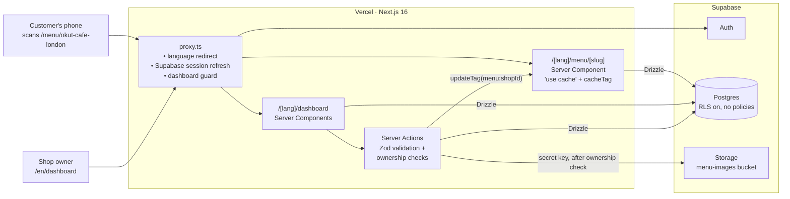
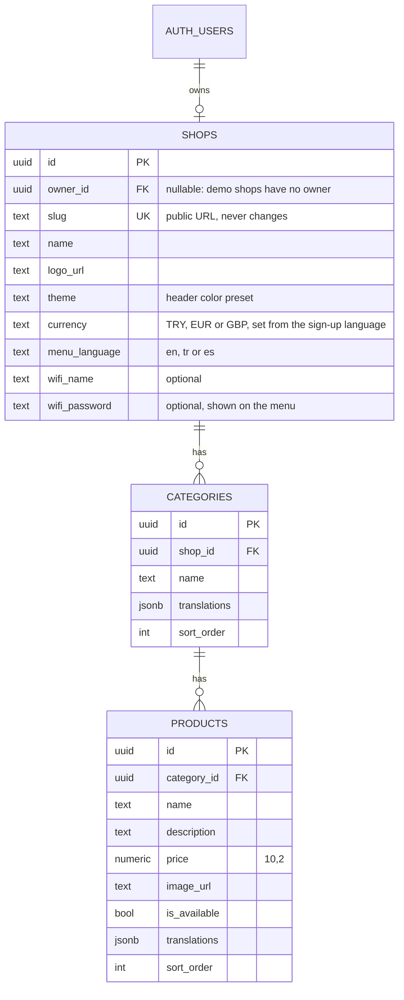

# Okut

**QR-code digital menus for cafés and restaurants.** Owners build their menu in a dashboard and print a QR table card; customers scan it and the menu opens in their phone's browser, in their own language. No app, no sign-up.

**Live:** [okut.vercel.app](https://okut.vercel.app) · Demo menus: [Istanbul (TRY)](https://okut.vercel.app/menu/okut-cafe-istanbul) · [London (GBP)](https://okut.vercel.app/menu/okut-cafe-london) · [Madrid (EUR)](https://okut.vercel.app/menu/okut-cafe-madrid)

*Okut* is Turkish for "scan it". The app is available in English, Turkish and Spanish.

| | |
|---|---|
| **Stack** | Next.js 16 (App Router, Server Actions, Cache Components) · React 19 · TypeScript · Supabase (Auth, Postgres, Storage) · Drizzle ORM · Zod · Tailwind CSS 4 · shadcn/ui |
| **Hosting** | Vercel (app) · Supabase (database, auth, file storage) |
| **Highlights** | Multi-tenant authorization in code with RLS as a backstop · per-language static prerendering with typed dictionaries · tag-based cache invalidation · client-side image compression · locale-aware currency formatting |

---

## Try it

1. Open [okut.vercel.app](https://okut.vercel.app). You land on `/en`, `/tr` or `/es` depending on your browser language; switch with the flag menu in the header.
2. Scan the QR code in the "Live demo" section with your phone (or click "Open the menu on this device"). Each language shows a café typical of its country: a Turkish café in lira, a London café in pounds, a Madrid café in euros.
3. Tap a menu item to open its detail sheet.
4. Click **Get started free** to create your own shop and try the dashboard: add categories, products and photos, mark items sold out, download your QR code or print a table card.

## Features

**For shop owners**
- **Menu editor:** categories and products with prices, descriptions and photos, edited inline.
- **Sold-out toggle** with optimistic UI: the item stays on the menu, greyed out with a "Sold out" badge.
- **Photo uploads:** resized and re-encoded to WebP in the browser before upload, so a 5 MB phone photo becomes ~100–400 KB.
- **QR codes:** download as PNG or SVG, or print a ready-made table card.
- **Overview:** menu stats, recently edited items and a "menu health" check for missing photos or descriptions.
- **Settings:** rename the shop (the menu URL never changes, so printed QR codes keep working), upload a logo, pick one of six header colors with a live preview, and optionally share the guest Wi-Fi.

**For customers**
- Mobile-first menu with sticky category navigation and a bottom-sheet detail view for each item.
- Guest Wi-Fi behind a header icon: a bottom sheet on phones (a dialog on larger screens) with a one-tap copy for the password.
- Opens in the phone's language; prices follow that language's conventions (`£3.50`, `3,50 €`, `₺650`).
- Served from cache, refreshed the moment the owner saves a change.

## Architecture



### Data model



Deleting a user cascades to their shop, categories and products.

## Engineering decisions

### Security and multi-tenancy
- **All data access is server-side.** Pages and Server Actions query Postgres through Drizzle. Row Level Security is enabled on every table with **no policies**, so even with the publishable key from the browser, the Supabase Data API can't read or write a single row. RLS is the backstop; authorization lives in code.
- **Every write is scoped to the caller's shop.** Each Server Action resolves the signed-in user's shop (`requireUserId` → `getOwnedShop`) and filters every query by it. Passing another shop's category or product ID simply matches nothing.
- **Uploads go through the server.** Photos are validated (type and size, also enforced by the bucket), uploaded with the secret key only after the ownership check, and old files are deleted when replaced.
- **Safe post-login redirects.** The `next` parameter is resolved as a URL and rejected unless it stays on the site, which blocks tricks like `/\evil.com`.
- **Read-only demos without special cases.** The demo shops have `owner_id = NULL`. Since every dashboard query looks up "the shop owned by this user", no account can ever reach them; no `isDemo` flag needed.

### Internationalization
- **Language in the URL.** Every page lives under `app/[lang]` and `generateStaticParams` prerenders `/en`, `/tr` and `/es` separately, so pages stay static while being fully translated.
- **QR codes have no language.** A printed code points to `/menu/<slug>`; `proxy.ts` redirects it to the visitor's saved choice or their `Accept-Language`. One QR serves every tourist.
- **Typed dictionaries.** Turkish and Spanish are typed against the English source, so a missing or misspelled key fails the build.
- **Right API for each context.** Server Components read the language with `next/root-params`. Server Actions can't, so the proxy keeps a locale cookie in sync with the URL for them.
- **Locale-aware money.** Prices are stored as `numeric(10,2)` and formatted with `Intl.NumberFormat` in the visitor's language and the shop's currency. Owners type prices the way they write them (`1.250,50` in Turkish and Spanish, `1,250.50` in English).

### Performance
- **Cached menus with precise invalidation.** `getPublicMenu` uses `"use cache"` and tags each entry with `menu:<shopId>`. Owner edits call `updateTag()`, so only that shop's menu is regenerated. Unknown slugs are cached for minutes instead of forever, so a newly created shop never gets stuck on a cached 404.
- **Static where possible.** The landing page, including its QR code, is prerendered per language; the public menu uses Partial Prerendering.
- **Small images.** Photos are compressed in the browser before upload and served through `next/image`.

## Project structure

```
src/
├── app/
│   ├── [lang]/                 # Every page, prerendered per language (en, tr, es)
│   │   ├── page.tsx            # Landing page
│   │   ├── dashboard/          # Owner dashboard: overview, menu editor, QR codes, settings
│   │   └── menu/[slug]/        # Public, cached customer menu
│   └── auth/                   # Sign-in / sign-up Server Actions, email confirmation
├── components/                 # Auth dialog, language menu, landing sections, shadcn/ui
├── db/schema.ts                # Drizzle schema (single source of truth for migrations)
├── i18n/                       # Locales, typed dictionaries, server/client helpers
├── lib/                        # Auth, storage, menu caching, currency, QR, formatting
└── proxy.ts                    # Language redirects, session refresh, dashboard guard
drizzle/                        # Generated SQL migrations
scripts/
├── seed-demo-menu.mts          # Creates the three read-only demo cafés
├── demo-menus/                 # Menu data per country
└── demo-images/                # Demo photos (see CREDITS.md)
```

## Running locally

**Requirements:** Node.js 20+, pnpm and a free [Supabase](https://supabase.com) project.

```bash
pnpm install
cp .env.example .env.local   # fill in from Supabase: Connect, Project Settings → API Keys
pnpm db:migrate              # tables and the menu-images storage bucket
pnpm db:seed                 # optional: the three demo cafés
pnpm dev                     # http://localhost:3000
```

`SUPABASE_SECRET_KEY` is used on the server only and must never be exposed to the browser.

| Command | Description |
|---|---|
| `pnpm dev` | Development server |
| `pnpm build` / `pnpm start` | Production build and server |
| `pnpm lint` / `pnpm typecheck` | ESLint / route types + TypeScript |
| `pnpm db:generate` | Generate a migration from schema changes |
| `pnpm db:migrate` | Apply migrations |
| `pnpm db:studio` | Drizzle Studio |
| `pnpm db:seed` | Create or refresh the demo cafés |

## Known limitations and next steps

- **Automated tests.** There are none yet; end-to-end tests (Playwright) for sign-up, menu editing and the public menu are the first thing I'd add, followed by CI on pull requests.
- **Abuse limits.** Sign-up is open and there are no per-shop limits on categories, products or uploads yet. Uploads are checked by declared MIME type; verifying file signatures is planned.
- **Free-tier pausing.** Supabase pauses free projects after a week without database activity; a daily keep-alive cron is planned.
- **Email confirmation** is currently off; turning it on needs a custom SMTP provider.
- **Reordering** categories and products, and editing menu translations from the dashboard, are not available yet.

## Credits

Demo photos are from [Unsplash](https://unsplash.com), used under the [Unsplash License](https://unsplash.com/license); photographers are credited in [`scripts/demo-images/CREDITS.md`](scripts/demo-images/CREDITS.md).
