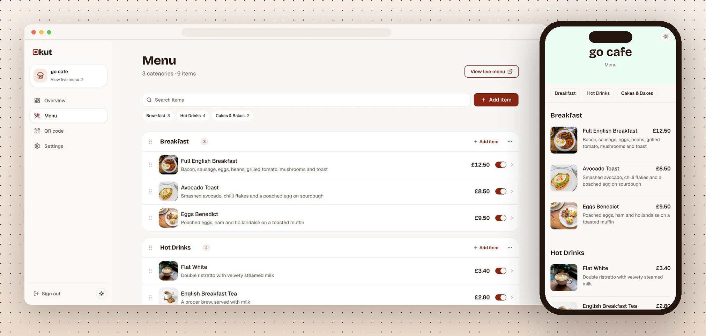
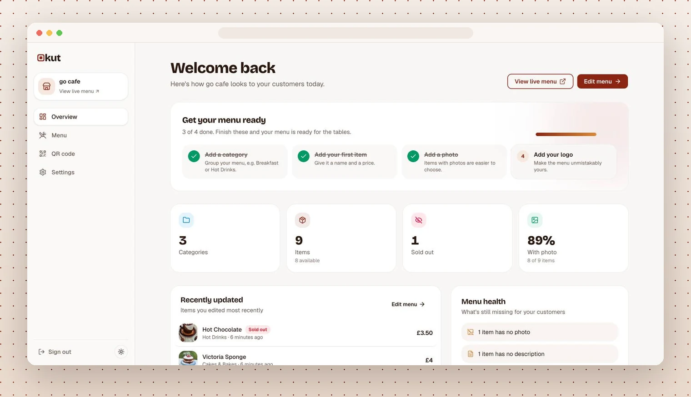
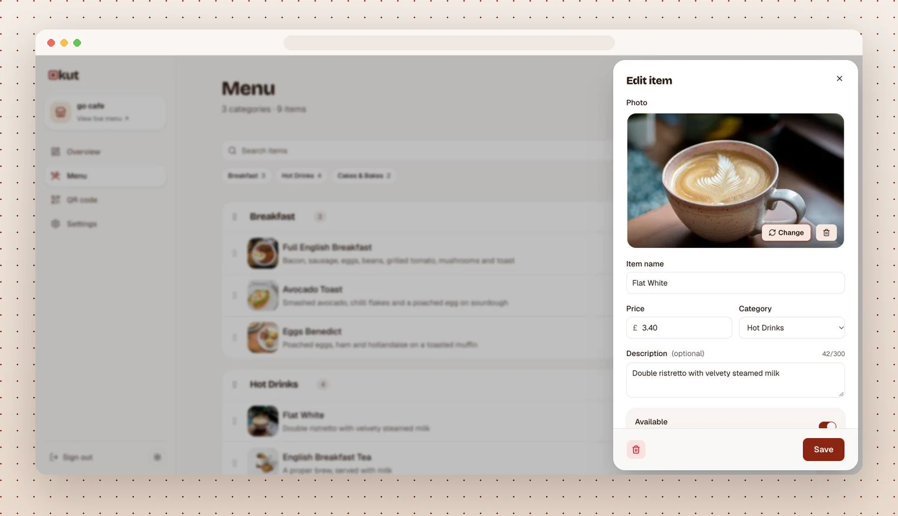
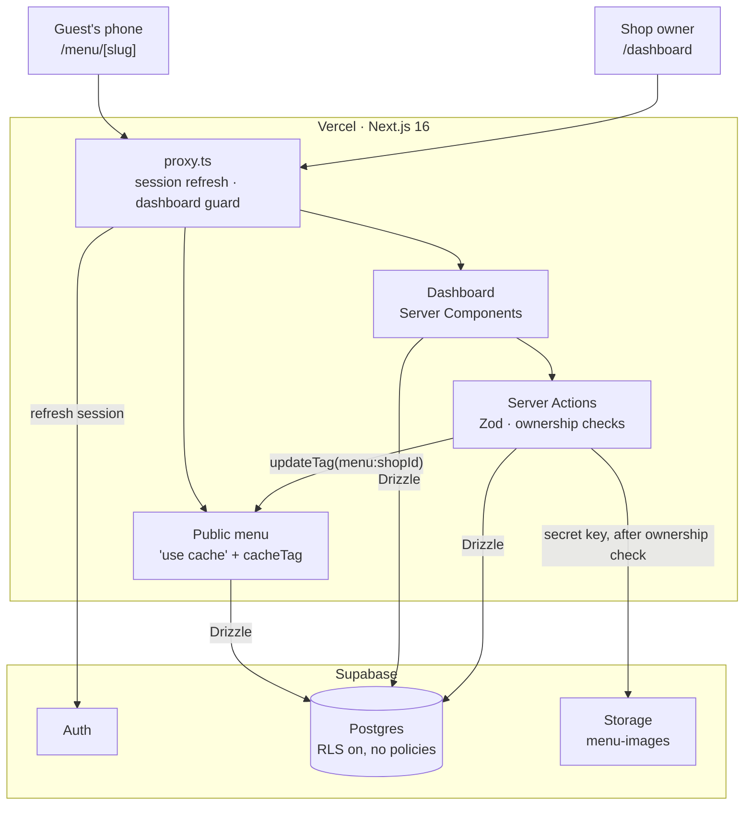
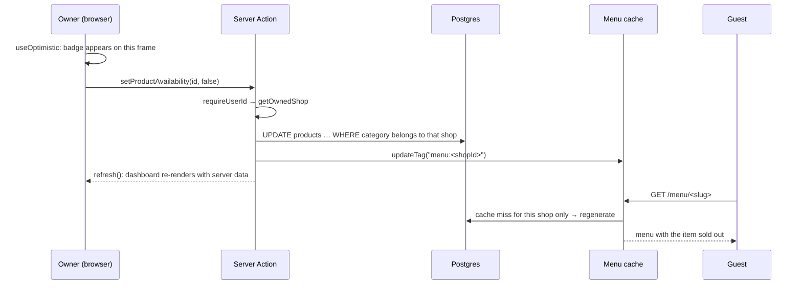
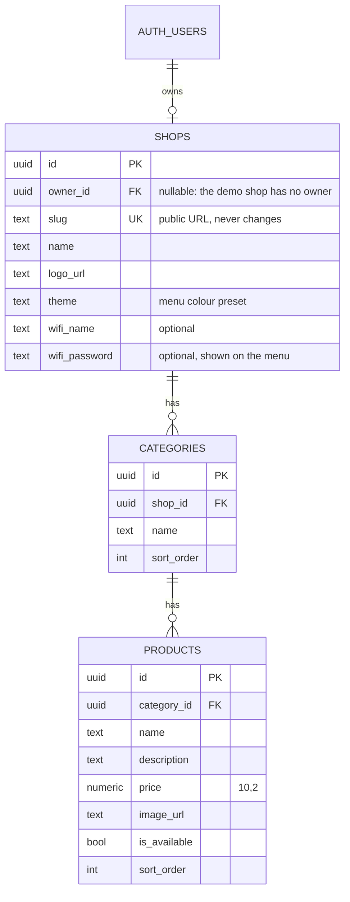

# Okut

**QR-code menus for independent cafés.** Owners build their menu in a dashboard and put a QR card on each table. Guests scan it and the menu opens in their phone's browser: no app, no sign-up, always current.

**[Live app](https://okut.vercel.app)** · **[Demo menu](https://okut.vercel.app/menu/okut-cafe)** · Built with Next.js 16, React 19, Supabase and Drizzle



| | |
|---|---|
| **What it is** | A complete multi-tenant SaaS: marketing site, auth, owner dashboard, public menus, file uploads |
| **Stack** | Next.js 16 (App Router, Server Actions, Cache Components) · React 19 · TypeScript · Supabase (Auth, Postgres, Storage) · Drizzle ORM · Zod · Tailwind CSS 4 · Base UI |
| **Hosting** | Vercel (app) · Supabase (database, auth, file storage) |
| **Worth a look** | [Authorization model](#authorization-lives-in-code-rls-is-the-backstop) · [Cache invalidation](#public-menus-are-cached-forever-and-invalidated-precisely) · [Optimistic editing](#the-editor-responds-before-the-server-does) · [What I'd do next](#limitations-and-next-steps) |

---

## The problem

A small café changes its menu more often than it reprints it. Prices go up, the scones sell out by 11, a seasonal drink comes and goes. Printed menus fall behind, and existing QR-menu tools are either PDF uploads (unreadable on a phone) or restaurant platforms with far more setup than a café needs.

Okut takes the opposite approach: **one screen to edit, one link that never changes, and a menu that is fast on any phone.**

| Overview | Editing an item |
|---|---|
|  |  |

## Try it in a minute

1. Open the [demo menu](https://okut.vercel.app/menu/okut-cafe) on your phone, or scan the QR code on the [home page](https://okut.vercel.app). This is what a guest sees.
2. Back on the home page, click **Create your shop**. Sign-up creates your account and your shop in one step.
3. In the dashboard, add a category (or tap a suggestion), add a few items with photos, drag them into order, and mark one sold out.
4. Open **View live menu** in another tab. Every change is already there.

## Features

**For owners**
- **Menu editor:** categories and items with prices, descriptions and photos. Drag to reorder (mouse, touch or keyboard), search across the menu, rename in place, move an item to another category.
- **Fast data entry:** a side panel with "Save & add another", one-tap category suggestions for a new menu, and a toast after every change.
- **Sold out in one tap:** the item stays on the menu, greyed out with a badge, so guests don't ask for it.
- **Photos without effort:** drop in a phone photo; it is resized and re-encoded to WebP in the browser before upload.
- **QR codes:** download as PNG or SVG, or print a ready-made table card.
- **Overview:** a setup checklist for new shops, menu stats, recently edited items, and a "menu health" check for missing photos or descriptions.
- **Settings:** shop name, logo, six menu colours and guest Wi-Fi, with a live phone preview and a save bar that appears only when something changed.

**For guests**
- Mobile-first menu with sticky category navigation and a detail sheet for each item.
- Guest Wi-Fi behind a header icon, with one-tap copy for the password.
- Light and dark themes that follow the device.

---

## Architecture



### Lifecycle of an edit

What happens between an owner flipping "sold out" and a guest seeing it:



### Data model



Deleting a user cascades to their shop, categories and products. The schema in `src/db/schema.ts` is the single source of truth; migrations in `drizzle/` are generated from it.

---

## Engineering decisions

Each of these was a choice between reasonable options. Here's what I picked and what it costs.

### Authorization lives in code; RLS is the backstop

All reads and writes go through Drizzle on the server. Row Level Security is **enabled on every table with no policies**, so the Supabase Data API can't read or write a single row, even with the publishable key that ships to the browser.

Every Server Action resolves the caller's shop (`requireUserId` → `getOwnedShop`) and scopes each query by it. A product update is `WHERE id = $1 AND category_id IN (the shop's categories)`, so a forged ID matches nothing instead of needing a separate check. Uploads use the Storage secret key, but only after that same ownership check.

*Trade-off:* the database can't enforce tenancy for me, so a careless new query could leak data. I accepted that for one place to reason about access (TypeScript, type-checked, reviewable) instead of splitting rules between SQL policies and app code. RLS still guarantees the public API is closed.

### Public menus are cached forever and invalidated precisely

`getPublicMenu` uses `"use cache"` with `cacheLife("max")` and tags each entry `menu:<shopId>`. Every owner mutation calls `updateTag()` for that shop only, so one café's edit never invalidates anyone else's menu. A guest almost always gets a cached page, and the first guest after an edit gets fresh data.

Unknown slugs are cached for minutes, not forever, so a shop created after someone visited its URL never gets stuck on a cached 404. The landing page, including its QR code, is fully prerendered; the menu uses Partial Prerendering.

### The editor responds before the server does

Toggling availability and reordering use `useOptimistic` with a reducer, following the patterns in the Next.js interactive-apps guide. The UI changes on the click frame; the Server Action saves and calls `refresh()`, and the server's data replaces the optimistic state. An expected error comes back as a result and the change reverts with a toast.

Reorders are written in one transaction, and they deliberately keep `updated_at`: moving an item isn't an edit, so it shouldn't push the item to the top of "Recently updated".

Drag and drop uses `@dnd-kit` because it supports touch and keyboard out of the box. Everything else (toasts, menus, dialogs, sheets) is built on Base UI, which the project already used, so no other UI dependencies were added.

### Photos are compressed in the browser and validated on the server

Phone photos are 3–10 MB. The browser downscales them to 1200 px and re-encodes to WebP (JPEG where WebP encoding isn't available), usually to a few hundred KB, before upload. That keeps uploads fast on café Wi-Fi and stays well under the 2 MB limit.

The server doesn't trust the client: it checks type and size again, and the bucket enforces both. Files get unique paths, so they're cached for a year, and replaced or deleted photos are removed from storage.

### Small choices that prevent support tickets

- **The menu URL never changes.** Renaming a shop keeps its slug, so printed QR codes keep working.
- **The demo is just data.** The demo shop has `owner_id = NULL`. Every dashboard query asks for "the shop owned by this user", so no account can ever reach it, and no `isDemo` flag exists anywhere.
- **Redirects can't leave the site.** The post-login `next` parameter is resolved as a URL and rejected unless it stays on the origin, which blocks tricks like `/\evil.com`.
- **Prices are parsed forgivingly.** Owners can type `3.5`, `£3.50` or `1,250.00`; prices are stored as `numeric(10,2)` and shown with `Intl.NumberFormat("en-GB")`.

### Removing code was a feature

Okut first shipped in Turkish, English and Spanish, with every route under `app/[lang]`, per-row translation columns and a currency per shop. When the product narrowed to one market (UK cafés), I deleted all of it rather than keep one-entry lists around. A migration dropped the columns, every UI string moved into one typed module (`src/lib/dictionary.ts`), and permanent redirects keep old `/tr`, `/en` and `/es` links working.

---

## Project structure

```
src/
├── app/
│   ├── page.tsx              # Landing page
│   ├── dashboard/            # Owner dashboard: overview, menu editor, QR codes, settings
│   │   ├── actions.ts        #   Shop settings Server Actions
│   │   └── menu-actions.ts   #   Category/product Server Actions, incl. reordering
│   ├── menu/[slug]/          # Public, cached guest menu
│   └── auth/                 # Sign-in / sign-up actions, email confirmation
├── components/
│   ├── landing/              # Landing page sections
│   └── ui/                   # Design system: buttons, sheet, toast, menus…
├── db/schema.ts              # Drizzle schema
├── lib/                      # Auth, storage, menu cache, QR, formatting, UI strings
└── proxy.ts                  # Session refresh and dashboard guard
drizzle/                      # Generated SQL migrations
scripts/                      # Demo café seed script, menu data and photos
```

## Running locally

**Requirements:** Node.js 20+, pnpm, and a free [Supabase](https://supabase.com) project.

```bash
pnpm install
cp .env.example .env.local   # fill in from Supabase: Connect, Project Settings → API Keys
pnpm db:migrate              # tables and the menu-images storage bucket
pnpm db:seed                 # optional: the demo café
pnpm dev                     # http://localhost:3000
```

`SUPABASE_SECRET_KEY` is used on the server only and must never be exposed to the browser.

| Command | Description |
|---|---|
| `pnpm dev` | Development server |
| `pnpm build` / `pnpm start` | Production build and server |
| `pnpm lint` / `pnpm typecheck` | ESLint / route types and TypeScript |
| `pnpm db:generate` | Generate a migration from schema changes |
| `pnpm db:migrate` | Apply migrations |
| `pnpm db:studio` | Drizzle Studio |
| `pnpm db:seed` | Create or refresh the demo café |

## Deploying

The live app runs on Vercel. Set `NEXT_PUBLIC_SUPABASE_URL`, `NEXT_PUBLIC_SUPABASE_PUBLISHABLE_KEY`, `SUPABASE_SECRET_KEY` and `DATABASE_URL` (the transaction pooler, port 6543) for every environment. `DIRECT_URL` is only needed for migrations and seeding.

In Supabase, set **Authentication → URL Configuration** so the Site URL is the deployed domain and `/auth/confirm` is an allowed redirect. Vercel's `VERCEL_PROJECT_PRODUCTION_URL` is used to prerender the landing page QR code with the right domain.

## Limitations and next steps

In rough priority order:

1. **Automated tests.** There are none yet; type checking, lint and the production build are the current safety net. First I'd add Playwright tests for sign-up → add item → see it on the public menu, plus unit tests for price parsing and the redirect guard, run in CI on every pull request.
2. **Abuse limits.** Sign-up is open and there are no per-shop limits on items or uploads. Uploads are checked by declared MIME type; verifying file signatures is planned.
3. **Account lifecycle.** Owners can't yet delete their shop or account from the dashboard, and email confirmation is off until a custom SMTP provider is set up.
4. **Free-tier pausing.** Supabase pauses free projects after a week without database activity; a daily keep-alive cron is planned.

## Credits

The wordmark and link previews use [Bricolage Grotesque](https://fonts.google.com/specimen/Bricolage+Grotesque) (SIL Open Font License, see [`assets/fonts/OFL.txt`](assets/fonts/OFL.txt)). Demo photos are from [Unsplash](https://unsplash.com), used under the [Unsplash License](https://unsplash.com/license); photographers are credited in [`scripts/demo-images/CREDITS.md`](scripts/demo-images/CREDITS.md).

*Okut* is Turkish for "scan it". The logo's "o" is a QR code's finder pattern, and the brand colour is *tavşan kanı*, the deep red of well-brewed Turkish tea.
